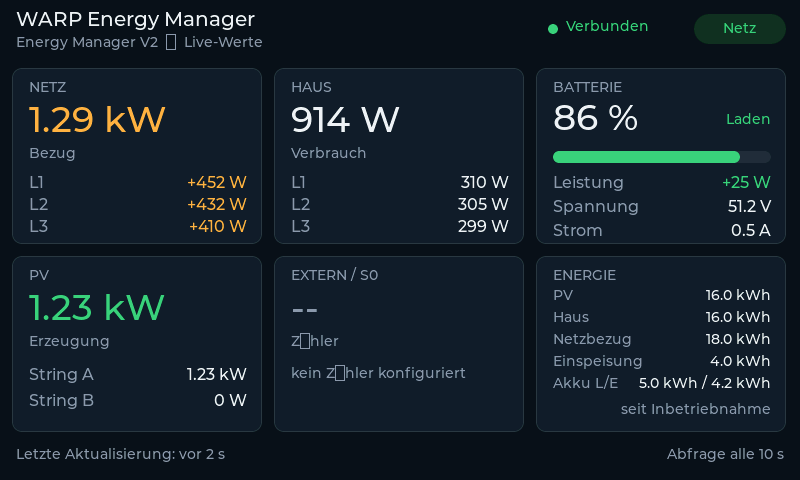

# WARP Energy Manager V2 panel

An ESP32-S3 panel (7" Waveshare, 800x480) that shows the live state of a WARP
Energy Manager V2: grid per phase and exchange, PV, external/S0, household,
battery SOC/power/voltage/current, island mode and energy totals.

The desktop emulator is the primary development target. It runs the same LVGL UI
source as the firmware and talks to the same WARP HTTP API.



## Why the earlier attempt showed no data

The `rct-panel` emulator only knows three device drivers: `SIM` (its own mock),
`RCT` (TCP) and `OIG` (TCP). It has no WARP HTTP driver. Pointing it at a WARP
device therefore connects nothing useful: the data source and the display never
meet.

The other trap is that a real WARP firmware does **not** serve a flat `/json`
endpoint (`/json` is 404). It exposes modules instead:

```
/info/name, /info/version
/meters/N/config, /meters/N/value_ids, /meters/N/values
/power_manager/low_level_state
```

`src/warp/WarpApi.h` discovers the configured meter slots, identifies them by
their WARP location (Grid, Battery, Load, PV) and maps the values by
`MeterValueID`. `src/warp/WarpParse.h` remains as a fallback for a flat JSON
bridge.

## Quick start (emulator)

Requirements: `g++`, SDL2, zlib, LVGL sources. LVGL is taken from the sibling
PlatformIO install by default:

```
../rct-panel/.pio/libdeps/esp32-s3/lvgl
```

Override with `LVGL_DIR=/path/to/lvgl`.

```sh
./run.sh                     # starts the module-API mock on :8082, opens the window
./run.sh --shot out.png      # render one frame and exit
./run.sh --probe             # print the mapped values, no window
```

The mock serves the real module API and also keeps a flat `/json` for the
fallback parser. Its values drift (`--live`), so the page visibly updates every
10 s.

Scenarios:

```sh
./run.sh --url 'http://localhost:8082?scenario=island'
./run.sh --shot island.png --url 'http://localhost:8082?scenario=island'
```

Available: `midsummer`, `evening`, `island`, `low_solar`, `grid_failure`. The
query string is carried through to every module request, so the emulator sees
the selected scenario without restarting the mock.

## Real device

The WEM2 on the development network is at `192.168.1.222`:

```sh
./run.sh --url http://192.168.1.222
./run.sh --probe --url http://192.168.1.222
SDL_VIDEODRIVER=dummy ./run.sh --url http://192.168.1.222 \
  --shot screenshots/real.png --after 4
```

`--probe` prints the discovered meter slots and the mapped values, so a broken
field mapping is visible immediately. It falls back to printing the raw body if
the URL is a flat JSON endpoint.

### Meter mapping

The adapter reads the slot configuration and value IDs, then selects the values
the UI needs:

| Role | WARP location | Values |
|---|---|---|
| grid | 4 | power L1/L2/L3 `39/48/57`, total `74`, import `209`, export `211`, voltage `1/2/3`, frequency `361` |
| battery | 5 | voltage `10`, current `396`, power `404`, charge `413`, discharge `415`, SOC `387` |
| household | 6 | power L1/L2/L3 `39/48/57`, total `74`, energy `215` |
| PV | 7 | string power `442/443`, total `452`, string energy `454/456`, total `472` |

A meter is also matched by its `virtual_meter` value and, as a last resort, by
keywords in `display_name` ("Netz", "Akku", "PV", "Verbrauch", ...). If no grid
or battery meter is configured, the adapter falls back to
`/power_manager/low_level_state` for `power_at_meter`, `power_at_battery` and
`battery_soc`.

Signs: grid positive = import, negative = export. Battery positive = charging,
negative = discharging. Island mode is inferred when all grid phase voltages are
near zero while PV or the battery is active.

### Flat fallback field names

`src/warp/WarpParse.h` maps a flat JSON object to `WarpData`. Each field accepts
a few aliases; the first match wins.

| UI | JSON keys (first match) |
|---|---|
| grid L1/L2/L3 | `grid_power_l1..l3`, `grid_l1..l3` |
| grid exchange | `grid_exchange`, `grid_power`, `grid_power_total` |
| PV strings | `pv_power_a`, `pv_power_b` |
| PV total | `pv_power`, `pv_power_total` (else A+B) |
| external / S0 | `external_power`, `s0_power` |
| household L1/L2/L3 | `household_power_l1..l3`, `house_power_l1..l3` |
| household total | `household_power`, `house_power` (else sum) |
| battery | `battery_soc`, `battery_power`, `battery_voltage`, `battery_current` |
| island | `island_flag`, `island`, `island_mode` |
| energy totals | `pv_energy_wh`, `house_energy_wh`, `grid_import_wh`, `grid_export_wh`, `battery_charge_wh`, `battery_discharge_wh` |
| today (legacy) | `day_generation_wh`, `day_load_wh`, `day_feed_in_wh`, `day_grid_draw_wh` |
| identity | `device_name`, `firmware_version` |

The energy card shows the cumulative meter totals since commissioning. The
period counters (day/month/year) are not in the UI yet; the WARP daily-history
endpoint is available if they should come from the device rather than from a
panel-side baseline.

## Layout

```
src/warp/       data model, module-API adapter, JSON scanner, flat fallback
src/ui/         LVGL screen, shared by emulator and firmware
sim/            SDL2 emulator, POSIX HTTP client, lv_conf override
tools/warp_mock/  module-API mock with scenarios
boards/         PlatformIO board definitions (Waveshare 7", Guition 4")
include/        lv_conf.h used by both builds
```

## Firmware

The firmware builds the same `src/warp` and `src/ui` sources as the emulator,
plus the display, touch and backlight drivers for the Waveshare 7" board.

```sh
pio run                 # build
pio run -t upload       # flash over USB
pio device monitor      # serial log, 115200
```

First boot opens the captive portal **WARP-Panel** at
<http://192.168.4.1/>. Enter the WLAN credentials and the WARP base URL
(default `http://192.168.1.222`; a trailing `/json` is accepted and normalized).
The URL is stored in NVS; the portal only needs to be opened again when the
address changes. OTA is enabled under the hostname `warp-panel`.

The display/touch driver files in `src/display` and `src/board` are ported from
the MIT-licensed `rct-panel` project; their headers carry the original notes on
the panel timings and the CH422G expander.

## Status

- Module-API adapter: verified against the real WEM2 at `192.168.1.222`; all four
  meter slots (grid, PV, household, battery) map to the expected values.
- Emulator, mock and UI: working, verified by rendered frames.
- Firmware: compiles for the 7" board (1.44 MB flash, 52 kB static RAM). Nothing
  has run on the panel yet; display bring-up is the open item.

## License

MIT.
