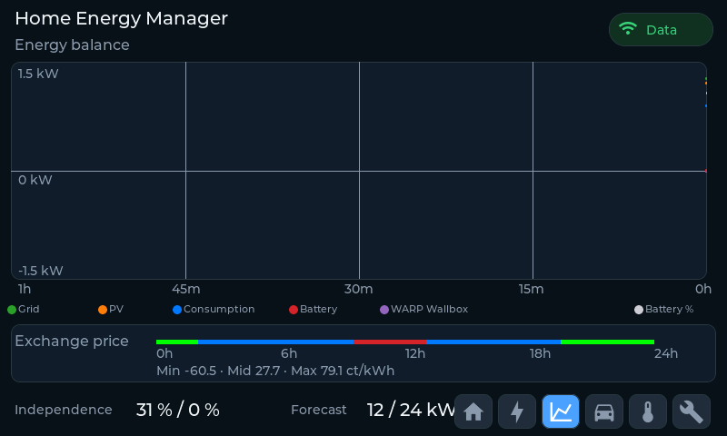

# Energy values: counters, autarky, forecast and prices

The panel distinguishes three kinds of energy data: cumulative meter counters,
derived values such as autarky and forecast, and the day-ahead exchange price
used for the price band. The raw value IDs are in
[warp-api.md](warp-api.md#meter-mapping).

## Energy counters

WARP reports the meter energy value IDs in **kWh**. The panel converts them to Wh
on ingest and prints them as kWh below 1 MWh and as MWh above.

The `ENERGIE HEUTE` card on the energy page shows today's sums from the device's
daily history:

- generation (PV),
- household consumption,
- grid import,
- feed-in,
- wallbox charging,
- battery charge and discharge, as `charge / discharge`.

The `ZÄHLER` card on the service page shows the cumulative counters since
commissioning:

- generation (PV),
- household consumption,
- grid import,
- feed-in,
- wallbox charging, summed over every wallbox meter,
- battery charge and discharge.

The wallbox counters come from meter slots with location `Charger` (2) or
`Vehicle` (8). If several wallboxes have their own meter, the panel adds their
energy counters together. Today's wallbox value is the day-over-day difference of
the same meter slots in the daily history; see [wallbox.md](wallbox.md#energy).

On this installation the load meter normally covers the whole house connection,
including a wallbox. The displayed household power has the wallbox power
subtracted; see [wallbox.md](wallbox.md).

## Autarky

Overall autarky is the share of consumption that was not drawn from the grid. It
is calculated from the cumulative counters:

```
autarky = (household energy - grid import) / household energy * 100 %
```

The result is clamped to 0–100 %. The flat JSON fallback also accepts an
`autarky` / `autarkie` / `self_sufficiency` field from the backend and uses it
when present.

Today's autarky uses the device's daily energy history. The counters of today
and the previous day are differenced, so no panel-side baseline is needed:

```
autarky today = (consumption delta - grid-import delta) / consumption delta * 100 %
```

The load counter is preferred for the consumption delta. When it is missing,
did not advance, or is smaller than the grid-import delta (for example because
it excludes a wallbox that the grid meter sees), the panel derives consumption
from the energy balance instead:

```
consumption = PV + grid import + battery discharge - battery charge - feed-in
```

If no plausible consumption figure remains, today's value stays unset and the
panel shows only the overall value rather than a misleading `0 %`. This needs a
grid meter, the device RTC and two consecutive daily rows. The daily-history
stride is derived from the response, so devices that record five meter slots
(WARP4) and seven (WEM2) both work. The bottom bar prints today's value first
and the overall value second, for example `82 % / 77 %`.

## Solar forecast

The forecast comes from `/solar_forecast/state`:

| Field | Meaning |
|---|---|
| `wh_today` | planned PV generation for today, Wh |
| `wh_today_remaining` | part of today's forecast still ahead, Wh |

The module reports `-1` while it has no usable data; the panel then shows `--`
instead of `0 kWh`. When both values exist, the bottom bar shows
`remaining / planned`, for example `12 / 24 kWh`.

## Day-ahead exchange prices

The price band is shown on the energy balance page when the dynamic tariff is
enabled. It covers the next 24 hours and is built from two endpoints:

| Endpoint | Fields used |
|---|---|
| `/day_ahead_prices/config` | `enable`, `vat`, `grid_costs_and_taxes`, `supplier_markup` |
| `/day_ahead_prices/prices` | `first_date`, `resolution`, `prices` |

The price endpoint returns raw spot prices. The panel calculates the final tariff
as:

```
final = (spot + grid costs and taxes + supplier markup) * (1 + VAT)
```

`first_date` is the start of the price series in Unix minutes. `resolution`
selects 15-minute or 60-minute slots. Prices are refreshed about every 15
minutes, not on every 10-second poll.

The band uses four states: low, medium, high and negative. Low is below the
midpoint between the median and the minimum of the visible window; high is
above the midpoint between the median and the maximum. Negative prices are
below zero and use a bright-green colour, so they are not folded into the low
bucket. Grey means no data. The line below the band shows the minimum, average
and maximum in ct/kWh for the visible 24 hours.

The price band is only shown when the tariff is enabled, prices are available
and the device clock is set.


