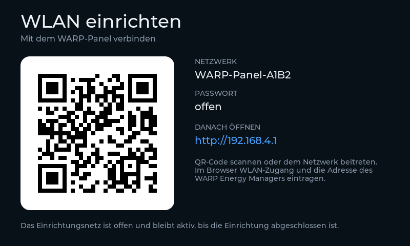
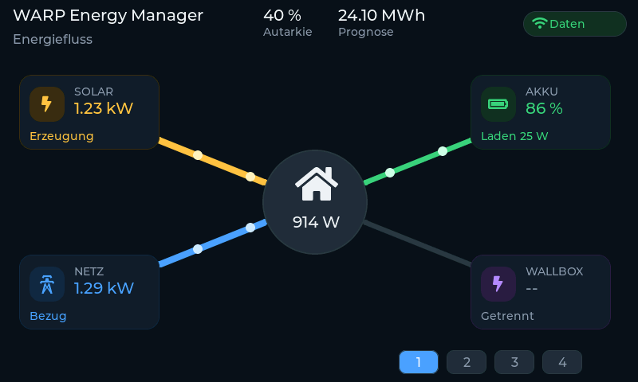
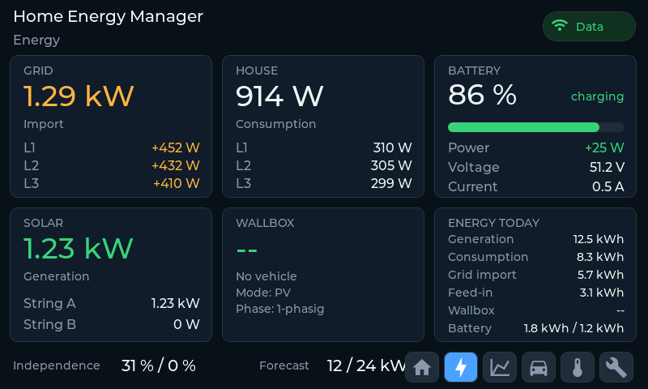
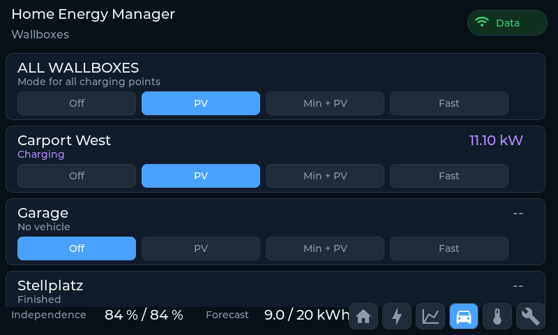

# WARP Energy Manager Panel - Kurzanleitung

## 1. Firmware installieren

Das Panel wird ueber USB direkt aus dem Browser geflasht.

- Chrome, Edge oder Firefox (aktuell)
- USB-Kabel, das Daten uebertraegt (kein reines Ladekabel)
- Das Panel ist per USB mit dem Rechner verbunden

1. Die Installations-Seite oeffnen, Geraet und Sprache waehlen.
2. Auf **Install** klicken.
3. Im Dialog den USB-Port des Panels auswaehlen.
4. Warten, bis der Fortschritt 100 % erreicht. Das Panel startet danach neu.

Das Installieren loescht alles auf dem Panel. Fuer ein bereits
eingerichtetes Panel das Update im Panel selbst verwenden.

## 2. Einrichtung

Das Panel startet ein offenes WLAN namens **WARP-Panel** (kein Passwort).
Verbinde dich damit - es erscheint ein Einrichtungsbildschirm mit QR-Code.

Dort eintragen:

- Dein WLAN (Name und Passwort)
- Adresse des WARP Energy Managers im lokalen Netzwerk

Das Panel wechselt danach selbst in die normale Anzeige und bleibt dort,
bis die Verbindung steht. Danach ist das Panel im eigenen WLAN erreichbar,
auch ueber seinen mDNS-Namen.

## 3. Die Seiten

Unten im Display sind sechs Tasten. Per Fingertipp wechselt die Anzeige.

| Seite | Name | Was sie zeigt |
|---|---|---|
| 1 | Energiefluss | Live-Fluss zwischen Solar, Netz, Akku und Wallbox. Die Punkte auf den Linien zeigen die Flussrichtung. Unten links: Eigenversorgung heute/gesamt und die Solarprognose. |
| 2 | Energie | Zaehlerstaende des Tages: Bezug, Einspeisung, Erzeugung, Verbrauch, Akku und Wallboxen. |
| 3 | Energiebilanz | Verlauf der letzten 24 Stunden als Diagramm (Netz, PV, Verbrauch, Akku, Wallboxen 1-2) mit Schaltereingangen, Relais und SG-Ready-Zustaenden unten. |
| 4 | Wallboxen | Lademodus je Wallbox (wie in der Weboberflaeche des WARP Energy Managers). |
| 5 | Heizung | SG-Ready-Status, Aussentemperaturen, Partymodus-Taste (2 Stunden Override). |
| 6 | Einstellungen | Netzwerkstatus, WLAN-Wechsel, Hintergrundbild an/aus, Service-Informationen. |

## 4. Hinweise

- Bricht das Flashen ab, einfach erneut installieren.
- Die Installations-Seite muss ueber https aufgerufen werden
  (Ausnahme: localhost auf dem eigenen Rechner).
