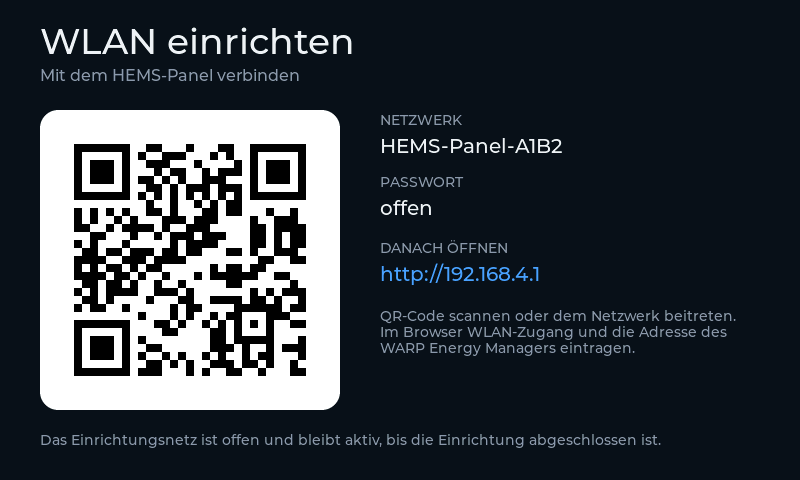

# First-time setup and network

On first boot, or when the saved WLAN cannot be reached, the panel opens a setup
access point:

- SSID: `HEMS-Panel-XXXX` — the last four hex digits of the chip MAC.
- Password: none, the setup access point is open.
- Portal: <http://192.168.4.1/> — the captive portal usually opens by itself.

The panel shows a QR code that contains the open WLAN join data
(`WIFI:T:nopass;S:...;;`), so a phone can join the access point by scanning it.
The same screen shows the SSID, `offen` instead of a password, and the portal
URL. The setup access point has no timeout and stays active until the WLAN is
configured; the panel only leaves the setup screen after it has joined the
user's WLAN.

## The portal

The portal has two fields:

1. **WLAN** — SSID and password of the local network.
2. **WARP Energy Manager (IP oder Hostname)** — a bare address such as
   `192.168.1.222`, a hostname, or a full URL.

The WARP address is normalized to `http://<address>` before it is stored in
NVS. A trailing `/json` is still accepted for the flat fallback, but a real
WARP firmware serves the module API, not `/json`. The reader is reset when the
address changes, so the next poll uses the new endpoint immediately.

The panel uses DHCP. Only the WARP address is configured manually.

## After the first connection

The same configuration page stays available on the local network, normally at
<http://hems-panel.local/> (mDNS) or at the panel's IP address. It can be used
to change the WARP address without wiping the WLAN credentials.

The service page (page 6) shows the current WLAN, the panel IP, the WARP endpoint
and the web setup URL. The WARP endpoint is displayed without the `http://`
scheme, even though the panel accesses it over HTTP.

If a WLAN change made through the local web page cannot be reached, power-cycle
the panel. The setup access point opens again because the saved connection
failed. OTA is enabled under the hostname `hems-panel`.

The build-time default endpoint is `http://192.168.1.222`; the portal remains the
supported way to change it in the field.
