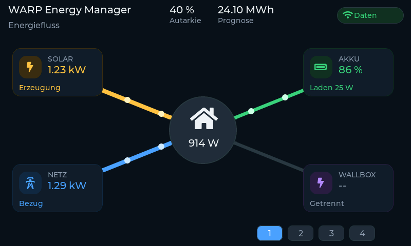

# Pages and user interface

The screen is built with LVGL and is shared byte-for-byte by the firmware and the
desktop emulator. The layout is designed for the 800 × 480 panel; the emulator
renders the same widgets into an SDL window.

German is the default language. The English build uses the same pages and
translates the labels at compile time.

## Page order

Six pages are reached with the icon buttons at the bottom right. The active page
has a highlighted caption at the top left.

| Position | German | English | Content |
|---|---|---|---|
| 1 | Energiefluss | Energy flow | live PV, grid, battery and wallbox around the house |
| 2 | Energie | Energy | current powers, battery state, wallbox and energy counters |
| 3 | Energiebilanz | Energy balance | 24 h power chart, wallbox series and exchange price |
| 4 | Wallboxen | Wallboxes | one card per charger with its charge-mode buttons |
| 5 | Heizung | Heating | SG-Ready state, 24 h history, temperatures, party mode |
| 6 | Service | Service | background, network, meters and I/O status |

The flow page is the first page users see. The energy, history, wallbox, heating
and service pages follow it in that order.

## Header and bottom bar

The header holds one compact connection chip:

| State | Meaning |
|---|---|
| `Kein WLAN` | no network; the Wi-Fi glyph is muted |
| `Getrennt` | WLAN is up but the WARP device cannot be reached |
| `Daten` | WARP is reachable and measurements are arriving |
| `Keine Daten` | WARP is reachable but the response has no usable values |

The Wi-Fi glyph is green while the network is up and grey without one. The chip
sits at the far right of the header.

The bottom bar, left of the page buttons, shows two values:

- **Autarkie** — today's and overall self-sufficiency, for example `82 % / 77 %`.
  If today's value is not available, only the overall value is shown.
- **Prognose** — today's remaining and planned solar forecast in kWh, for
  example `12 / 24 kWh`.

The calculations behind both values are in [energy.md](energy.md).

## Energy flow

The first page is a live energy-flow view:

- PV at the top left, grid at the bottom left, battery at the top right and the
  wallbox at the bottom right, around a central house hub.
- Each node has a coloured icon badge, a name, a live value and a short state
  line.
- The link width and the particle speed follow the actual power. Particle
  movement carries the direction.
- PV is amber, grid blue, battery green, wallbox violet and the house neutral.
- Active flows are bright; inactive flows stay dim so the topology remains
  readable.
- In island mode the grid link is dimmed and the grid card shows
  `Inselbetrieb`.
- A missing meter shows `--` / `kein Messwert` instead of hiding the card.

The animation is deliberately cheap: one LVGL timer at 12.5 fps, two small
particles per active link, and invalidation only of the particle rectangles. The
timer returns immediately while the flow page is hidden, and the line width is
updated only when new data arrives.

## Energy page

The energy page shows the current state as cards:

- grid power per phase and the grid exchange,
- household power,
- battery SOC, power, voltage and current,
- PV strings and PV total,
- wallbox power, state, mode and phase count,
- today's energy sums (`ENERGIE HEUTE`), including the wallbox meters.

The wallbox card marks calculated power as `geschätzt`; see
[wallbox.md](wallbox.md).

## Energy balance

The energy balance page is a 24 h chart with one sample per minute. The visible
window can be 1, 2, 4, 6, 12 or 24 hours. The chart draws grid, PV, consumption,
battery and up to two wallboxes, plus the battery SOC. A tap on the chart shows
the sample values in the legend for 30 seconds.

Below the chart, the day-ahead exchange-price band is shown when the dynamic
tariff is enabled; see [energy.md](energy.md#day-ahead-exchange-prices).

## Heating page

The heating page is for a heat pump controlled through SG-Ready:

- **SG-READY** card: `Blockiert (SG1)`, `Erweitert (SG2)`, the current status and
  the `§14a EnWG` state,
- a 24 h history band for the SG-Ready states,
- **PARTYMODUS**: a two-hour override button; a tap is shown immediately and is
  replaced by the polled state when the device confirms it,
- **TEMPERATUR**: current outdoor temperature, today's min/max and tomorrow's
  min/max.

The page is populated from `/heating/state`, `/heating/sgr_blocking_override`,
`/temperatures/state` and `/energy_manager/state`; the endpoint details are in
[warp-api.md](warp-api.md).

## Service page

The service page contains:

- **HINTERGRUND** — cycles the page background between black, grey and white, and
  switches the flow-page background image on and off,
- **NETZWERK** — WLAN, panel IP, WARP endpoint, the local web setup URL and the
  SD-card status line (see [sd-log.md](sd-log.md)),
- **ZÄHLER** — generation, consumption, grid import, feed-in and battery energy
  since commissioning,
- **I/O STATUS** — one dot each for four inputs, two relays and two SG-Ready
  outputs.

The network card is the pointer to the configuration portal when the WARP address
has to be changed; see [setup.md](setup.md).
