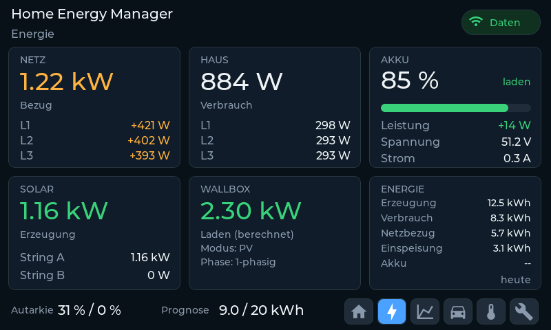
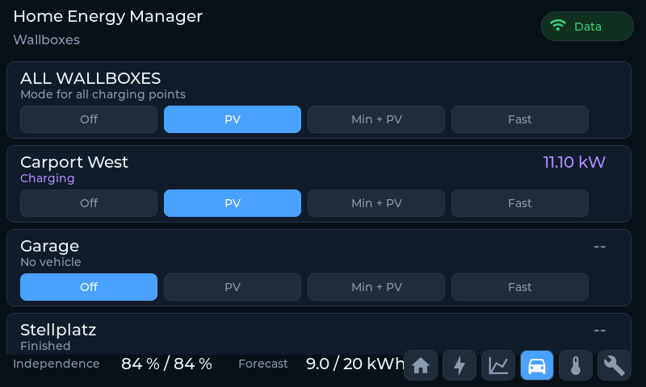

# Wallboxes

The panel shows wallbox power on the flow page and the energy page, and provides
a charge-mode page for every charger that the WARP charge manager reports.

## Power: meter or estimate

When a wallbox has its own meter, the panel reads the power from a meter with
location `Charger` (2) or `Vehicle` (8). It prefers the total power value and
falls back to the three phase values.

Without a wallbox meter, the panel estimates the charging power from the
allocated current in `/charge_manager/state` (`ac`, in mA) and the measured grid
phase voltages:

```
P = ac / 1000 * (V1 + V2 + V3)   # 3 allocated phases
P = ac / 1000 * V1               # 1 allocated phase
```

`ap` (allocated phases) selects one or three phases; `sp` (supported phases) and
`is_3phase` are fallbacks. Missing phase voltages fall back to 230 V, so the
estimate also works in island mode while the grid meter is off.

The load meter normally measures the whole house connection, including the
wallbox. The panel subtracts the wallbox power from the displayed household
power (clamped at zero) so the house value shows household consumption only.
The wallbox card marks calculated values as `geschätzt` and distinguishes them
from metered values.



## Energy

A wallbox meter also supplies an energy counter. The panel reads the import
counter (`209`) and falls back to the import-minus-export counter (`215`) when
that is all the meter provides. WARP reports both in kWh, so they are converted
to Wh on ingest.

Every meter with location `Charger` (2) or `Vehicle` (8) contributes to one
combined value:

- the `ZÄHLER` card on the service page shows the sum since commissioning,
- the `ENERGIE HEUTE` card on the energy page shows today's sum, taken from the
  day-over-day difference of the same slots in the device's daily history.

If no wallbox meter reports energy, both rows show `--`. A wallbox without its
own meter still appears with its calculated power, but contributes no energy
counter.

## Charge-mode page

Page 4 (`Wallboxen`) shows one card per charger reported by
`/charge_manager/state`, with its name, live power, state and a row of charge
mode buttons.

- The first card applies a mode to all boxes through
  `/power_manager/charge_mode_update` with the payload `{"mode": <int>}`.
- The per-box cards override a single charger through
  `/charge_manager/charge_modes/<index>` with the bare integer as the body.
- The buttons come from `/charge_manager/supported_charge_modes`, so only the
  modes the device currently offers are shown. WARP reports at most four:
  `Off`, up to two PV/Eco modes and `Fast`.
- A tap is shown immediately and is replaced by the polled value on the next
  refresh. If the device rejects the command, the selection falls back after
  about 15 seconds.
- The page scrolls when more wallboxes are configured than fit on the screen.

The mode values match the WARP charge manager:

| Mode | Value | Button |
|---|---|---|
| `Fast` | 0 | Schnell |
| `Off` | 1 | Aus |
| `PV` | 2 | PV |
| `MinPV` | 3 | Min + PV |
| `Default` | 4 | Standard |
| `Min` | 5 | Min |
| `Eco` | 6 | Eco |
| `EcoPV` | 7 | Eco + PV |
| `EcoMin` | 8 | Eco + Min |
| `EcoMinPV` | 9 | Eco + Min + PV |



The emulator has scenarios for one-phase, three-phase and metered wallboxes, and
for a configuration with three chargers; see [emulator.md](emulator.md#scenarios).
